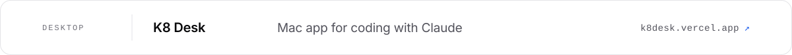
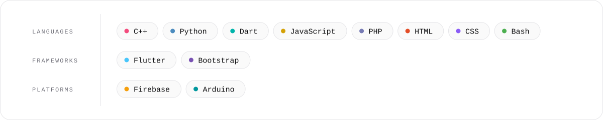

<picture>
  <source media="(prefers-color-scheme: dark)" srcset="./assets/hero-dark.svg" />
  
</picture>

<picture>
  <source media="(prefers-color-scheme: dark)" srcset="./assets/project-n2s-s1-dark.svg" />
  
</picture>

<picture>
  <source media="(prefers-color-scheme: dark)" srcset="./assets/project-n2s-ams-dark.svg" />
  
</picture>

<a href="https://k8desk.vercel.app/">
<picture>
  <source media="(prefers-color-scheme: dark)" srcset="./assets/project-k8-dark.svg" />
  
</picture>
</a>

<a href="https://qrpinas.vercel.app/">
<picture>
  <source media="(prefers-color-scheme: dark)" srcset="./assets/project-qrpinas-dark.svg" />
  
</picture>
</a>

<a href="https://www.cinecaptions.com/">
<picture>
  <source media="(prefers-color-scheme: dark)" srcset="./assets/project-cinecaptions-dark.svg" />
  
</picture>
</a>

<picture>
  <source media="(prefers-color-scheme: dark)" srcset="./assets/stack-dark.svg" />
  
</picture>
